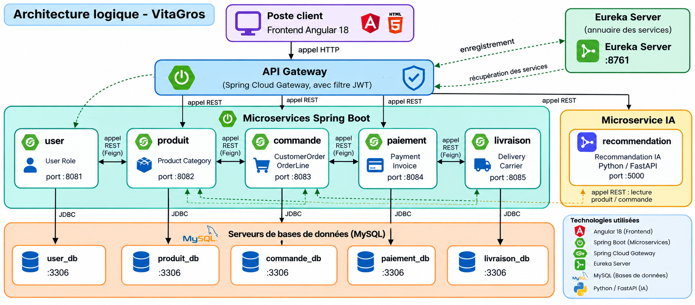
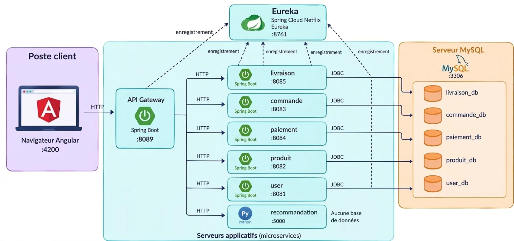
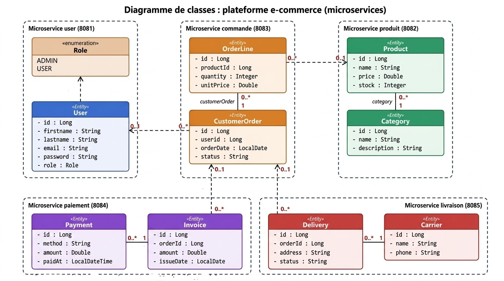

<div align="center">

# 🛒 VitaGros

**Plateforme e-commerce en architecture Microservices**
catalogue · commandes · paiement · livraison
</div>

---

## 📑 Sommaire
1. [Présentation](#-présentation)
2. [Cadrage et périmètre fonctionnel](#-cadrage-et-périmètre-fonctionnel)
3. [Architecture](#-architecture)
4. [Microservices](#-microservices)
5. [Contrats d'API et événements](#-contrats-dapi-et-événements)
6. [Modèle de données](#-modèle-de-données)
7. [Frontend](#-frontend)
8. [Répartition des tâches](#-répartition-des-tâches)
9. [Pilotage du projet](#-pilotage-du-projet)
10. [Installation et lancement](#-installation-et-lancement)
11. [Documentation des API](#-documentation-des-api)
12. [Structure du dépôt](#-structure-du-dépôt)

---

## 🎯 Présentation

VitaGros permet à un **client** de parcourir un catalogue, de passer commande, de payer et de suivre sa livraison, et à un **administrateur** de gérer l'ensemble de la plateforme.

L'application est découpée en **5 microservices autonomes** (user, produit, commande, paiement, livraison). Chacun possède son code, sa configuration, son port et sa **propre base MySQL** (*database per service*). Un serveur **Eureka** assure la découverte des services et un frontend **Angular 18** consomme les API REST.

| Acteur | Ce qu'il peut faire |
|---|---|
| **Client** (`USER`) | S'inscrire, se connecter, consulter les produits, commander, payer, suivre ses livraisons |
| **Administrateur** (`ADMIN`) | Gérer utilisateurs, produits, catégories, commandes, factures, paiements, transporteurs et livraisons |

---

## 🧭 Cadrage et périmètre fonctionnel

### Idée et besoin

| Élément | Description |
|---|---|
| **Nom** | VitaGros |
| **Contexte** | Vente en ligne de produits, avec un parcours d'achat complet jusqu'à la livraison |
| **Utilisateurs** | Clients (`USER`) et administrateurs (`ADMIN`) |
| **Problème résolu** | Permettre l'achat en ligne de bout en bout et offrir à l'administrateur un outil unique de gestion |

**Scénarios prioritaires :**
1. Un client s'inscrit, se connecte et consulte le catalogue.
2. Un client ajoute des produits au panier et passe une commande.
3. Un client règle sa commande et suit l'état de sa livraison.
4. Un administrateur gère les produits, les catégories, les commandes et les livraisons.

### Périmètre fonctionnel

| Domaine | Fonctionnalités retenues | Valeur métier |
|---|---|---|
| Utilisateurs | Inscription, connexion, gestion des rôles, profil | Accès sécurisé et personnalisé selon le rôle |
| Catalogue | Produits, catégories, stock | Présentation de l'offre et contrôle de la disponibilité |
| Commandes | Création de commande, lignes de commande | Traduction du panier en engagement d'achat |
| Paiement | Factures, paiements | Suivi financier de chaque commande |
| Livraison | Livraisons, transporteurs | Suivi de l'acheminement jusqu'au client |

**Limites connues :**
- ⚠️ À compléter : le paiement est-il connecté à un prestataire réel ou simulé ?
- ⚠️ À compléter : la gestion du stock est-elle décrémentée automatiquement à la commande ?
- Pas de notifications (courriel, SMS) à ce stade.

---

## 🏗️ Architecture

### Architecture logique
Découpage en services, entités portées par chaque service, base dédiée et enregistrement dans Eureka.



### Architecture physique (déploiement)
Poste client, serveurs applicatifs avec leurs ports, serveur MySQL et protocoles échangés.



### Composants

| Composant | Rôle | Statut |
|---|---|---|
| Frontend Angular | Interface client et administrateur | Implémenté |
| Eureka | Annuaire des services | Implémenté |
| 5 microservices | Logique métier par domaine | Implémentés |
| MySQL | Une base par service | Implémenté |
| API Gateway | Point d'entrée unique, routage | ⚠️ Non présent dans la structure actuelle (à confirmer ou à ajouter) |

### Principes retenus
- **Database per service** : aucune base partagée, aucune clé étrangère entre services.
- **Liens par identifiant** : `commande` référence `userId` et `productId` ; `paiement` et `livraison` référencent `orderId`. Ces liens sont de simples identifiants, sans transaction distribuée.
- **Service discovery** : chaque microservice s'enregistre dans Eureka au démarrage.
- **API REST documentées** par Swagger / OpenAPI sur chaque service.
- **Gestion d'erreurs homogène** : `400` validation, `404` introuvable, `409` conflit d'intégrité.
- **Création automatique des bases** au démarrage de chaque service.

### Communications
- **REST synchrone** (HTTP/JSON) entre le frontend et les microservices.
- **Découverte de services** via Eureka.
- ⚠️ À compléter : les services s'appellent-ils entre eux directement (ex. commande → produit pour vérifier le stock) ? Si oui, lister ces appels.
- Aucun échange asynchrone (événements, file de messages) identifié à ce jour.

### Sécurité
- Accès par rôle (`ADMIN` / `USER`) contrôlé côté frontend par un guard.
- ⚠️ À compléter : mécanisme d'authentification côté backend (JWT, session, autre) et règles d'autorisation par endpoint.
- ⚠️ À compléter : gestion des mots de passe (algorithme de hachage utilisé).

---

## 🧩 Microservices

| Service | Port | Base | Responsabilité | Swagger |
|---|---|---|---|---|
| **Eureka** | 8761 | — | Annuaire des services | [Dashboard](http://localhost:8761) |
| **user** | 8081 | `user_db` | Comptes et rôles (`ADMIN`, `USER`) | [Swagger](http://localhost:8081/swagger-ui.html) |
| **produit** | 8082 | `produit_db` | Catalogue : produits, catégories, stock | [Swagger](http://localhost:8082/swagger-ui.html) |
| **commande** | 8083 | `commande_db` | Commandes et lignes de commande | [Swagger](http://localhost:8083/swagger-ui.html) |
| **paiement** | 8084 | `paiement_db` | Factures et paiements | [Swagger](http://localhost:8084/swagger-ui.html) |
| **livraison** | 8085 | `livraison_db` | Livraisons et transporteurs | [Swagger](http://localhost:8085/swagger-ui.html) |

Chaque service a son propre `README.md` : [`user`](Backend/Microservices/user/README.md) · [`produit`](Backend/Microservices/produit/README.md) · [`commande`](Backend/Microservices/commande/README.md) · [`paiement`](Backend/Microservices/paiement/README.md) · [`livraison`](Backend/Microservices/livraison/README.md) · [`Eureka`](Backend/Eureka/README.md)

---

## 📜 Contrats d'API et événements

### Endpoints principaux

| Service | Ressources |
|---|---|
| user | `/api/users`, `/api/roles` |
| produit | `/api/products`, `/api/categories` |
| commande | `/api/orders`, `/api/order-lines` |
| paiement | `/api/invoices`, `/api/payments` |
| livraison | `/api/deliveries`, `/api/carriers` |

Chaque ressource expose `GET` (liste), `GET /{id}`, `POST`, `PUT /{id}` et `DELETE /{id}`.

### Événements
Aucun événement asynchrone n'est publié ou consommé à ce jour. Les échanges entre services, s'ils existent, sont synchrones (REST).

### Documentation des contrats
- Swagger UI disponible sur chaque service (voir [Microservices](#-microservices)).
- ⚠️ À compléter : export de la spécification OpenAPI en fichier versionné dans `documentation/`.

---

## 🗂️ Modèle de données



| Service | Entités | Relation interne |
|---|---|---|
| user | `User`, `Role` (enum `ADMIN` / `USER`) | `User.role` |
| produit | `Product`, `Category` | `Product` → `Category` (n:1) |
| commande | `CustomerOrder`, `OrderLine` | `OrderLine` → `CustomerOrder` (n:1) |
| paiement | `Invoice`, `Payment` | `Payment` → `Invoice` (n:1) |
| livraison | `Delivery`, `Carrier` | `Delivery` → `Carrier` (n:1) |

> Les références **entre** services (`userId`, `productId`, `orderId`) sont de simples identifiants, sans clé étrangère.

---

## 🖥️ Frontend

Application **Angular 18** (port 4200) qui appelle directement les microservices.

- Authentification : connexion, inscription, accès par rôle (`ADMIN` / `USER`) via un guard
- Tableau de bord et profil utilisateur
- Pages produits et catégories, panier, commandes, paiements, livraisons, utilisateurs

---

## 👥 Répartition des tâches

| Membre | Rôle | Composants sous sa responsabilité | Dépendances |
|---|---|---|---|
| ⚠️ À compléter | Responsable backend | user, produit | Eureka |
| ⚠️ À compléter | Responsable backend | commande, paiement | produit (vérification des produits) |
| ⚠️ À compléter | Responsable backend | livraison | commande |
| ⚠️ À compléter | Responsable frontend | Frontend Angular | Tous les services REST |
| ⚠️ À compléter | Intégration / DevOps | Dépôt Git, configuration MySQL, Eureka, démarrage | Tous |

**Stratégie d'intégration :** chaque service est développé et testé isolément (MySQL local, Eureka démarré), puis le frontend est branché sur les API une fois les contrats (Swagger) validés.

Chaque membre doit être capable d'expliquer les choix et sa contribution.

---

## 📋 Pilotage du projet

| Élément | Choix |
|---|---|
| **Outil de gestion** | ⚠️ À compléter (ex. Trello, Jira, GitHub Projects) |
| **Backlog** | ⚠️ À compléter : lien vers le tableau ou la liste des user stories |
| **Git** | Branche `main` stable ; branches de travail `feature/<nom>` ou `docs/<nom>` ; fusion par pull request |
| **Planning** | ⚠️ À compléter : dates des itérations et jalons (S4, soutenance finale) |

### Risques identifiés

| Risque | Impact | Mesure envisagée |
|---|---|---|
| Incohérence des données entre services (pas de transaction distribuée) | Commandes sans paiement ou sans livraison associés | Vérifications par identifiant et gestion des erreurs `409` |
| Services non enregistrés dans Eureka au moment d'un appel | Erreurs de communication | Ordre de démarrage documenté ci-dessous |
| Divergence entre contrats Swagger et implémentation | Blocage de l'intégration frontend | Revue des contrats avant intégration |
| Configuration MySQL différente selon les machines | Échec au démarrage | Configuration documentée dans chaque `application.properties` |

### Prochaine itération
⚠️ À compléter. Pistes : ajout d'une API Gateway, sécurisation des endpoints par JWT, tests d'intégration, export OpenAPI versionné.

---

## 🚀 Installation et lancement

### Prérequis
- JDK 17 et Maven
- Node 18.19+ ou 20
- MySQL sur `localhost:3306` (utilisateur `root`, mot de passe vide ; sinon modifier `src/main/resources/application.properties` de chaque service)

Les bases sont créées automatiquement au démarrage de chaque service.

### Démarrage (dans cet ordre)

```bash
# 1. Eureka
cd Backend/Eureka && mvn spring-boot:run

# 2. Les 5 microservices (un terminal chacun)
cd Backend/Microservices/user      && mvn spring-boot:run
cd Backend/Microservices/produit   && mvn spring-boot:run
cd Backend/Microservices/commande  && mvn spring-boot:run
cd Backend/Microservices/paiement  && mvn spring-boot:run
cd Backend/Microservices/livraison && mvn spring-boot:run

# 3. Frontend  ->  http://localhost:4200
cd Frontend && npm install && npm start
```

---

## 📘 Documentation des API

Chaque microservice expose :
- **Swagger UI** : `http://localhost:<port>/swagger-ui.html`
- **OpenAPI (JSON)** : `http://localhost:<port>/v3/api-docs`

---

## 📁 Structure du dépôt

```
Projet
├── Backend
│   ├── Eureka                       discovery server (8761)
│   └── Microservices
│       ├── user                     (8081)  User, Role (enum)
│       ├── produit                  (8082)  Product, Category
│       ├── commande                 (8083)  CustomerOrder, OrderLine
│       ├── paiement                 (8084)  Invoice, Payment
│       └── livraison                (8085)  Delivery, Carrier
├── Frontend                         Angular 18 (4200)
├── documentation                    schémas d'architecture et diagramme de classes
└── README.md
```

Organisation interne de chaque microservice :

```
com.awd.<service>
├── config        CORS, OpenAPI, gestion des erreurs
├── controller    API REST
├── entity        entités JPA
├── repository    Spring Data JPA
└── service       logique métier
```

---

Projet réalisé à **ESPRIT** dans le cadre du module d'architecture Microservices.